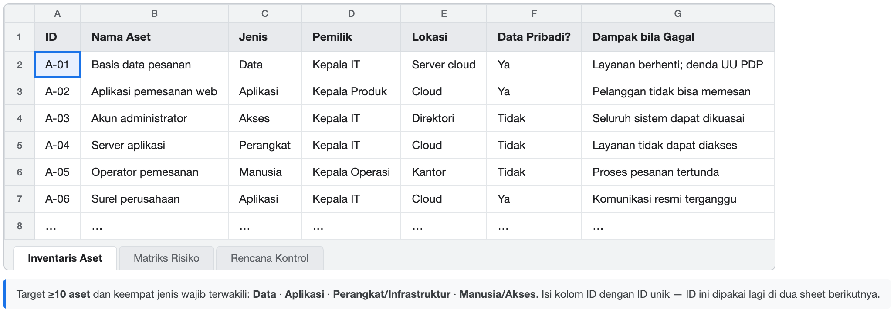
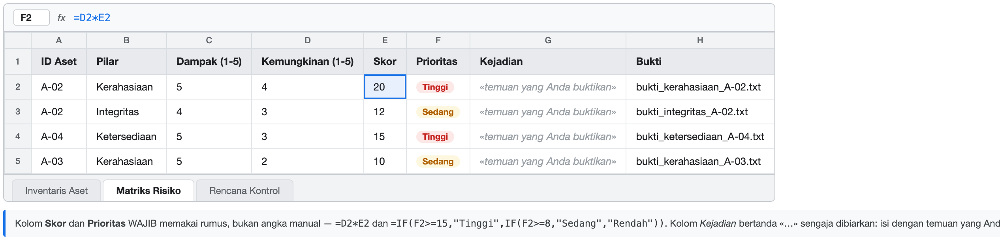
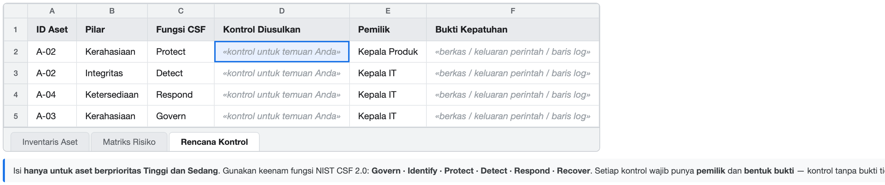
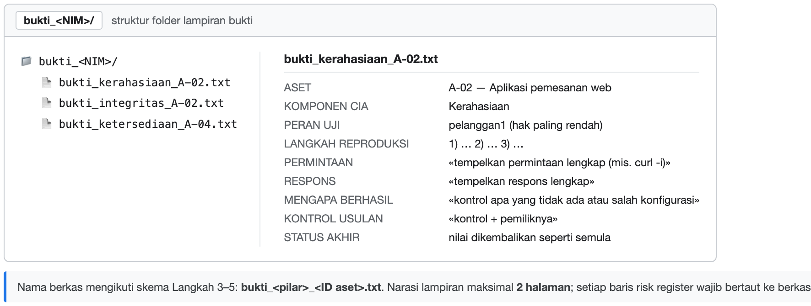

# Panduan Mahasiswa — BAB 1: Audit CIA pada Layanan Pemesanan B2B

**Praktikum 1** · Pekan 1–2 · **Tugas 1** · Rubrik **C1** · bobot **3%**

Selamat datang di praktikum pertama. Anda berperan sebagai **auditor keamanan**. Anda tidak
diminta membaca daftar risiko dari buku. Anda diminta **membuktikan sendiri** pelanggaran
kerahasiaan, integritas, dan ketersediaan pada layanan pemesanan B2B fiktif milik
**PT Nusantara Pasok Digital**, lalu menyusun risk register dari bukti yang Anda kumpulkan.

---

## ⚠️ 1. Baca dulu — aturan main

**Sebelum menyentuh apa pun:**

1. **Hanya container ini yang boleh diuji.** Aplikasi berjalan di `127.0.0.1 (localhost)` dan hanya boleh diuji di situ.
   Dilarang menyentuh sistem nyata, jaringan kampus, layanan pihak ketiga, atau data pribadi.
2. **Penggunaah AI** untuk menjawab pertanyaan praktikum **dilarang**. Anda boleh menanyakan hal-hal teknis, teori, atau konsep, berdiskusi tapi
   jawaban yang diberikan/digenerate oleh AI tidak dapat dijadikan bukti dan tidak akan dinilai. Anda harus membuktikan sendiri temuan Anda. Histori percakapan dengan AI **wajib** disertakan dalam laporan.
3. **Dilarang menyalin jawaban orang lain/Internet/Mahasiswa lain.** Setiap temuan harus dapat direproduksi oleh Anda sendiri.
4. **Dilarang menggunakan alat bantu otomatis** seperti script atau bot untuk melakukan uji coba. Anda harus melakukan uji coba secara manual.
5. **Dilarang mengubah kode sumber atau konfigurasi**. Anda hanya boleh menguji aplikasi sebagaimana adanya.
6. **Dilarang membagikan temuan atau bukti** dengan orang lain selain dosen pengampu. Temuan dan bukti hanya boleh digunakan untuk keperluan praktikum ini.
7. **Dilarang menyebarkan bahan praktikum ke luar kelas**. Semua berkas praktikum bersifat rahasia dan hanya boleh digunakan untuk keperluan praktikum ini.

---

## 2. Yang harus Anda hasilkan

| # | Luaran | Bentuk |
|---|---|---|
| 1 | **Risk register** | Spreadsheet `Praktikum1_<NIM>_<Nama>.xlsx`, 3 sheet: `Inventaris Aset`, `Matriks Risiko`, `Rencana Kontrol` |
| 2 | **Lampiran bukti** | Folder `bukti_<NIM>/`, narasi maksimal **2 halaman** |

**Ambang minimal modul:** ≥10 temuan dengan ID unik, yang memuat **bukti pelanggaran CIA** (
kerahasiaan, integritas, ketersediaan) yang dapat direproduksi. Temuan tanpa bukti yang
dapat diperiksa **dihapus dari penilaian**.

Aplikasi ini memuat **lebih dari tiga** masalah. Semakin banyak yang Anda buktikan dengan bukti
yang rapi, semakin kuat dimensi *Analisis bukti & dampak* pada rubrik C1.

### Contoh format luaran

Empat gambar berikut menunjukkan **format** yang diharapkan, bukan jawaban. Sel yang bertanda
«...» sengaja dibiarkan kosong: isi dengan temuan yang Anda buktikan sendiri.

**Sheet 1 — `Inventaris Aset`.** Tujuh kolom, ID unik, dan keempat jenis aset terwakili.



**Sheet 2 — `Matriks Risiko`.** Perhatikan kolom `Skor` dan `Prioritas`: keduanya **hasil rumus**
(`=D2*E2` dan `=IF(F2>=15,...)`), bukan angka yang diketik. Kolom `Kejadian` dan `Bukti` diisi
temuan Anda dan nama berkas buktinya.



**Sheet 3 — `Rencana Kontrol`.** Isi hanya untuk aset berprioritas Tinggi dan Sedang, dan pakai
keenam fungsi NIST CSF 2.0. Setiap kontrol wajib punya pemilik dan bentuk bukti.



**Lampiran bukti.** Nama berkas mengikuti skema `bukti_<pilar>_<ID aset>.txt`, dan setiap berkas
memuat bagian yang sama: aset, komponen CIA, langkah reproduksi, permintaan/respons, alasan
berhasil, kontrol usulan, dan status akhir.



> Jika gambar tidak muncul di preview Markdown Anda, buka langsung berkasnya di folder `contoh/`.

---

## 3. Cara menjalankan

### Dengan Docker (disarankan)

```bash
cd BAB1_Layanan_Pemesanan_B2B
docker compose up -d --build
# tunggu ±10 detik, lalu buka http://localhost:8081
```

Hentikan dan kembalikan ke keadaan semula (semua data dihapus):

```bash
docker compose down --volumes
```

### Tanpa Docker (cadangan)

```bash
cd BAB1_Layanan_Pemesanan_B2B
python3 -m venv .venv && source .venv/bin/activate
pip install -r requirements.txt
mkdir -p data
python3 -c "import sqlite3,pathlib;sqlite3.connect('data/pesanan.db').executescript(pathlib.Path('db/seed.sql').read_text())"
python3 -m flask --app app.main run --host 127.0.0.1 --port 8081
```

> Jangan pernah mengubah alamat bind menjadi `0.0.0.0`. Port hanya boleh terikat ke `127.0.0.1`.

---

## 4. Akun

| Nama | Sandi | Peran |
|---|---|---|
| `pelanggan1` | `rahasia` | pelanggan |
| `pelanggan2` | `rahasia` | pelanggan |
| `pelanggan3` | `rahasia` | pelanggan |
| `operator1` | `operator` | operator |
| `admin1` | `admin` | administrator |

Catat apa pun yang Anda anggap menyimpang dari best practice.

---

## 5. Langkah kerja dan bukti yang diminta

### Langkah 1 — Siapkan Vm
Nyalakan layanan, masuk dengan akun uji.

### Langkah 2 — Lingkup, peran, dan pemilik proses
Buat `Praktikum1_<NIM>_<Nama>.xlsx` dengan tiga sheet bernama persis `Inventaris Aset`,
`Matriks Risiko`, `Rencana Kontrol`. Tulis paragraf lingkup di `Inventaris Aset!A1:B1`.
**Daftar peran yang benar-benar ada pada layanan lab ini:** pelanggan, operator, administrator,
dan **proses terjadwal** (proses berkala yang memajukan status pesanan).
**Tuliskan asumsi Anda** — asumsi yang tidak ditulis dinilai sebagai klaim tanpa dasar.

### Langkah 3 — Inventaris aset
Kolom: `ID · Nama Aset · Jenis · Pemilik · Lokasi · Data Pribadi? · Dampak bila Gagal`.
**Target ≥10 aset** yang mencakup keempat jenis: data, aplikasi, perangkat/infrastruktur,
manusia/akses. Beri ID unik — ID ini dipakai lagi di sheet berikutnya dan di lampiran bukti.

### Langkah 4 — Buktikan pelanggaran kerahasiaan
Gunakan akun dan check hak aksesnya apakah terdapat anomali.
Catat **pasangan permintaan(request) dan respons(response)** secara lengkap, jelaskan mengapa akses itu berhasil
(kontrol apa yang tidak ada), lalu simpan:

```
bukti_kerahasiaan_<ID aset>.txt
```

### Langkah 5 — Buktikan pelanggaran integritas
Lakukan perubahan data via aplikasi, tunjukkan **tidak ada rekam
perubahan** yang mencatatnya, dan buktikan perubahan itu bertahan setelah halaman dimuat ulang.
Sebutkan peran yang seharusnya berwenang. **Kembalikan nilai semula** dan simpan
sebelum/sesudah:

```
bukti_integritas_<ID aset>.txt
```

### Langkah 6 — Buktikan gangguan ketersediaan, lalu pulihkan
Habiskan sumber daya yang dibatasi (kuota koneksi/memori) **hanya pada layanan lab Anda**, dengan
batas wajar. Catat waktu mulai, lama layanan tidak responsif, dan dampaknya bagi tiap peran.
Pulihkan (`docker compose restart` atau kembalikan snapshot) dan **catat waktu pemulihannya**:

```
bukti_ketersediaan_<ID aset>.txt
```

### Langkah 7 — Nilai dampak, kemungkinan, prioritas
Sheet `Matriks Risiko`, kolom: `ID Aset · Pilar · Dampak (1-5) · Kemungkinan (1-5) · Skor ·
Prioritas · Kejadian · Bukti`. Satu baris per temuan yang **benar-benar Anda buktikan**.
Skor dan Prioritas **wajib memakai rumus**, bukan angka manual:

```
=D2*E2
=IF(F2>=15,"Tinggi",IF(F2>=8,"Sedang","Rendah"))
```

### Langkah 8 — Petakan ke NIST CSF 2.0
Sheet `Rencana Kontrol`, kolom: `ID Aset · Pilar · Fungsi CSF · Kontrol Diusulkan · Pemilik ·
Bukti Kepatuhan`. Isi hanya untuk temuan berprioritas Tinggi dan Sedang. Gunakan keenam fungsi:
**Govern, Identify, Protect, Detect, Respond, Recover**. Setiap kontrol wajib punya pemilik dan
bentuk bukti.

### Langkah 9 — Susun lampiran bukti
Kumpulkan seluruh bukti di `bukti_<NIM>/`, tulis narasi maksimal 2 halaman (per temuan: aset,
komponen CIA, langkah reproduksi, kontrol usulan + pemilik), lalu **tautkan setiap baris risk
register ke berkas buktinya**.

### Checkpoint sebelum menutup sesi

- [ ] ≥10 temuan, masing-masing ber-ID unik
- [ ] Masing-masing temuan memiliki bukti CIA tersimpan dan dapat direproduksi
- [ ] Setiap baris temuan punya berkas bukti yang bertaut
- [ ] Kolom Skor dan Prioritas dihitung dengan rumus, bukan angka manual
- [ ] Setiap kontrol punya pemilik dan bukti

---

## 6. **Spoiler** 
Check dibawah ini untuk membantu Anda menelusuri kelemahan yang sengaja ditanam di aplikasi.

Aplikasi ini memang dibiarkan lemah, dan masalahnya tersebar di beberapa lapis. Berikut delapan arah
yang luas dan produktif yang dapat ditelusuri:

1. **Kepemilikan.** Apakah setiap halaman memeriksa *siapa* yang membuka **dan** apakah data itu
   memang miliknya?
2. **Rekam jejak.** Apakah setiap perubahan meninggalkan jejak yang dapat diaudit, dan apakah
   nilainya divalidasi?
3. **Batas.** Apakah setiap permintaan punya batas (limitasi), laju, ukuran, paginasi?
4. **Rahasia dan sesi.** Bagaimana kredensial, kunci, cookie sesi, dan data tersimpan
   dilindungi? Apakah peran berhak tinggi dilindungi faktor kedua?
5. **Berkas statis.** Apa saja yang tersedia di sana, dan apakah semuanya memang boleh terbuka?
6. **Respons dan header.** Apa yang diberitahukan server tentang dirinya pada setiap respons?
7. **Konfigurasi dan infrastruktur.** Sebagai pengguna apa kontainer berjalan, apa yang boleh
   dilakukannya, dan di alamat mana ia mendengarkan?
8. **Deteksi dan pemulihan.** Bila sesuatu terjadi, apakah ada catatan yang memungkinkan Anda
   mengetahuinya dan apakah layanan dapat pulih sendiri?

Petakan setiap temuan ke salah satu pilar CIA. Kalau Anda tidak yakin sebuah temuan masuk pilar
mana, tuliskan alasannya.

---

## 7. Jika terjadi masalah

| Gejala | Penyebab umum | Solusi |
|---|---|---|
| Rumus menampilkan `#VALUE!` | Sel berisi teks, bukan angka | Kolom Dampak/Kemungkinan hanya berisi 1–5 |
| Prioritas tidak berubah saat skor berubah | Rumus diganti angka manual | Hapus sel, tulis ulang rumusnya |
| Temuan kurang dari 10 | Lingkup terlalu sempit | Perluas ke proses bisnis lain (pembayaran, dukungan dll) |
| Bingung menentukan pemilik | peran belum didefinisikan | Pakai peran/jabatan, bukan nama orang |
| Bukti kerahasiaan tidak dapat dibuat | Endpoint yang disasar sudah benar | Pilih peran yang berhak paling rendah dan endpoint lain; bila tetap ditolak, catat sebagai kontrol yang sudah memadai |
| Perubahan integritas hilang saat halaman dimuat ulang | Dikerjakan pada salinan sementara | Ubah pada basis data praktik, muat ulang, simpan bukti sebelum/sesudah, kembalikan |
| Layanan tidak pulih setelah uji ketersediaan | Kuota terlampaui / snapshot belum diambil | Mulai ulang kontainer atau kembalikan snapshot, catat waktu pemulihan |
| `docker compose` gagal terhubung | Docker belum berjalan | Jalankan Docker Desktop, cek `docker info` |
| Port 8081 sudah dipakai | Kontainer lama masih hidup | `docker compose down` lalu `up -d` lagi |

---

## 8. Menutup sesi

```bash
# Docker — hentikan dan hapus seluruh data praktik
docker compose down --volumes
```

---

## 9. Kalau Anda buntu

1. Baca ulang bagian **Kisi-kisi** di atas dan pilih satu arah saja.
2. Jalankan ulang langkah dengan `curl -i` supaya Anda melihat **seluruh** permintaan dan respons,
   bukan hanya yang tampil di layar.
3. Bandingkan apa yang Anda lihat dengan apa yang seharusnya ada (perbedaan itulah temuan Anda).
4. Tulis asumsi Anda, lalu tanyakan kepada dosen. Pertanyaan yang baik menunjukkan Anda sudah
   memeriksa, bukan menebak.

> Aturan penting: **jangan menulis "berhasil" tanpa menjalankannya.** Setiap klaim pada laporan
> Anda harus punya bukti yang dapat diperiksa orang lain.
